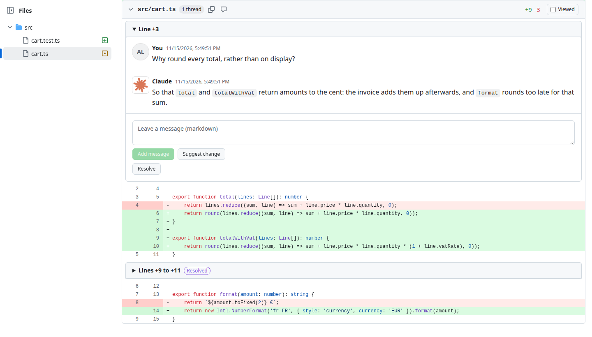
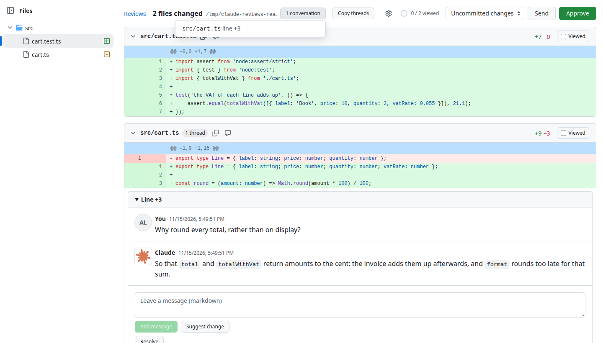
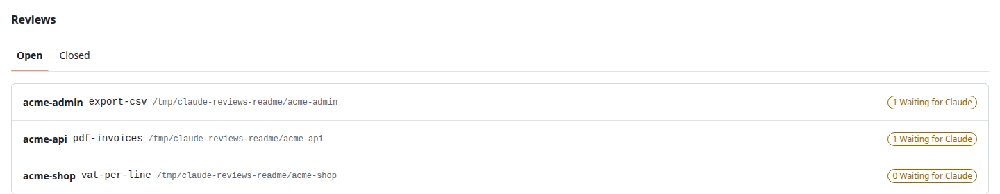
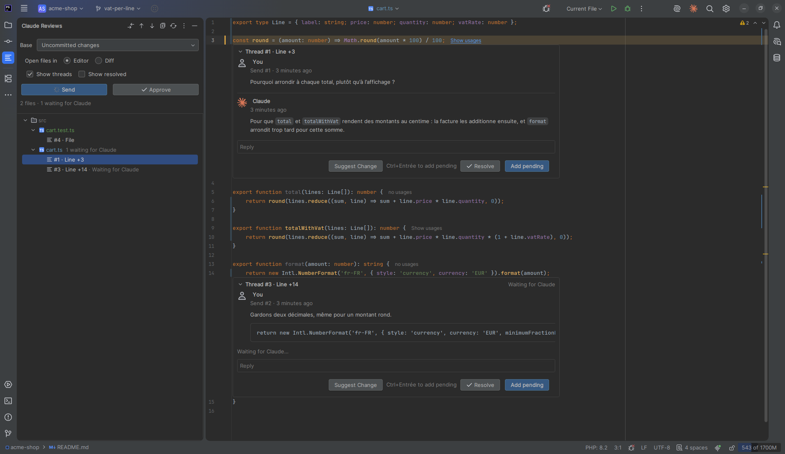
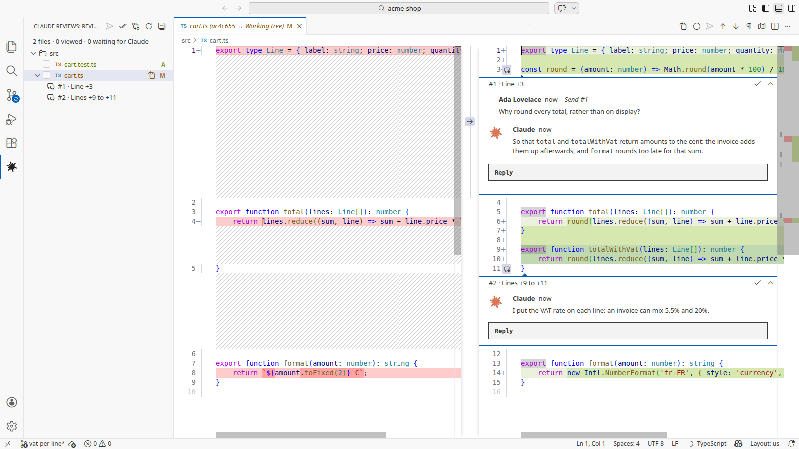

# claude-reviews

Review what Claude Code wrote in a local diff that looks like GitHub's "Files changed" tab,
with threads under the lines where Claude replies, without going through GitHub.



## Why

Claude Desktop and the other tools let you comment on a line of the diff, but Claude replies in the conversation, far from the code.
Here, each comment opens a thread anchored on its lines:
Claude replies in it, changes the code when the thread asks for it, and I resolve the thread when the question is settled.
The project's context and decisions are in [BRIEF.md](BRIEF.md), its vocabulary in [GLOSSARY.md](GLOSSARY.md).

## What you can do



- Review the diff of the worktree, uncommitted changes and untracked files included, against a base of your choice:
  HEAD, the code of my last Send, the default branch, the base branch, an open PR or any branch.
- Open a thread on a line, a range (Shift+click) or a whole file, with a message in markdown.
- Propose a change with a `suggestion` block: Claude applies it when it reads the thread.
- Send my messages with Send, which wakes the Claude session of the worktree, even an idle one;
  edit or delete a message as long as it is not sent.
- Follow the threads: they stay on their line when the code moves, and become Outdated when their lines disappear.
- Mark a file Viewed, until its content changes;
  go from one thread to another with `j` and `k`, or through the conversations menu.
- Copy the threads as markdown, for a PR description, then close the session with Approve.

The Reviews screen lists the sessions of all worktrees, those waiting for Claude first, and the closed sessions in a separate tab.



## Installation

You need Node 25 or later, and git 2.41 or later.

In Claude Code:

```
/plugin install local-reviews --marketplace nikophil/claude-reviews
```

The plugin starts your account's server on an ephemeral port of `127.0.0.1` when a Claude session opens in a git repository;
it writes its port and its token to `~/.local/share/claude-reviews/endpoint`, which only your account can read, and each client sends this token.
`CLAUDE_REVIEWS_PORT` sets the port: on a shared machine where you work over SSH, choose yours and forward the same number (`ssh -L <port>:127.0.0.1:<port>`).

## Usage

1. In a Claude session, run `/review-local`: the review session of the worktree opens in the browser, or in PhpStorm or VS Code, as you choose, when they are installed.
2. Click a line number, write, then Add message; the message stays Pending until the Send.
3. Send: Claude wakes up, replies in each thread waiting for it, and changes the code when a thread asks for it.
   A status line under its prompt counts the threads waiting for it.
4. Refresh when the banner says the code changed, reply, resolve the threads, then Approve.

To have Claude review its own work, ask it to review its diff and open threads:
it opens them with the `open_thread` tool, and they wait for you in the page.

## PhpStorm plugin

The PhpStorm plugin shows the same session in a "Claude Reviews" tool window, with the threads in the editor and in the IDE's diff.



Add this plugin repository once in Settings › Plugins › ⚙ › Manage Plugin Repositories, then install Local Reviews from the Marketplace tab:

```
https://github.com/nikophil/claude-reviews/releases/latest/download/updatePlugins.xml
```

PhpStorm then offers each release as an update.

The plugin also builds with the installed PhpStorm, without downloading anything:

```
npm run build:phpstorm
```

The command writes `var/phpstorm/updatePlugins.xml`:
add it once in Settings › Plugins › ⚙ › Manage Plugin Repositories (`file://…/updatePlugins.xml`), and PhpStorm will offer each build as an update.

## VS Code extension

The VS Code extension shows the same session in a "Claude Reviews" view, with the threads in the editor and in VS Code's diff.



Each GitHub release carries its `.vsix`, which VS Code does not update on its own outside its marketplace:

```
curl -LO https://github.com/nikophil/claude-reviews/releases/latest/download/local-reviews.vsix
code --install-extension local-reviews.vsix --force
```

It also builds with `zip`, without downloading anything:

```
npm run build:vscode
code --install-extension var/vscode/local-reviews.vsix --force
```

## Security

The server listens only on `127.0.0.1` and refuses other sites (`Host`, `Origin` and `Sec-Fetch-Site` headers, Content-Security-Policy).
Each account has its own server and token, which only that account can read ([ADR 0006](docs/adr/0006-one-server-and-one-token-per-account.md)):
on a machine shared over SSH, another account reaches the port, but gets nothing without the token.
The server never writes a file of the reviewed worktree: Claude applies a suggestion itself ([ADR 0007](docs/adr/0007-claude-applies-suggestions.md)).

## Development

```
npm ci
npm start
node --test
npx playwright test
```

`npm start` starts the server and writes its port and its token to `~/.local/share/claude-reviews/endpoint`; open `http://127.0.0.1:<port>/?worktree=<absolute path>#token=<token>`.
`npm run readme` regenerates the images of this README, except the PhpStorm screenshot, taken by hand in the IDE.
The repository's rules, the HTTP contract and the data format are in [CLAUDE.md](CLAUDE.md), the architecture decisions in [docs/adr/](docs/adr/).
